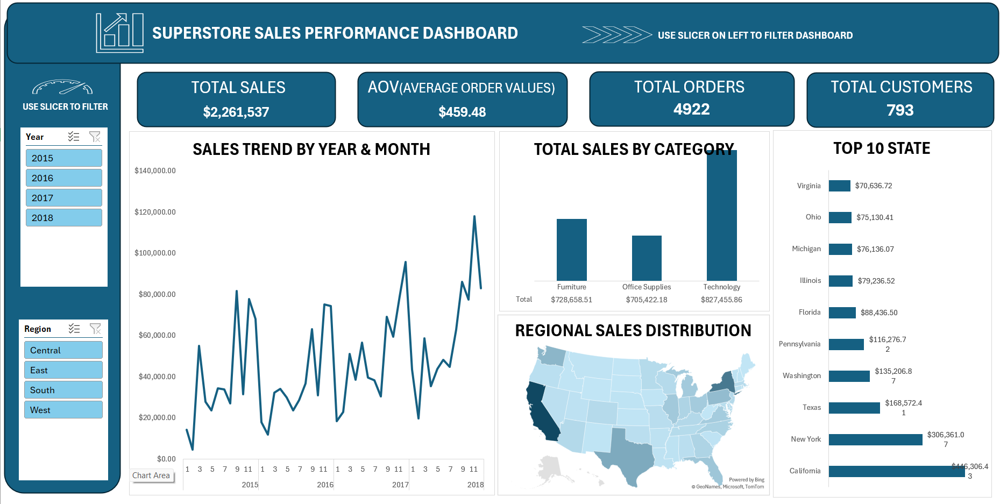
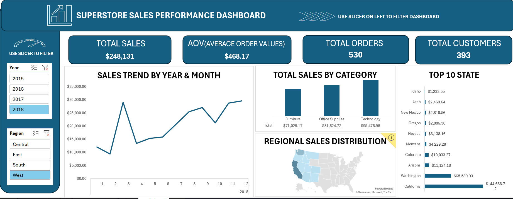

# Superstore Sales Performance Dashboard (Excel)

An interactive Excel dashboard analyzing 9,800 Superstore order rows (2015-2018). Every KPI, chart, and the map respond to the Year and Region slicers.

## Key Metrics (no filter)
| Metric | Value |
|---|---|
| Total Sales | $2,261,537 |
| Total Orders | 4,922 |
| Total Customers | 793 |
| Average Order Value | $459.48 |

## Features
- **Data cleaning with Power Query:** fixed data types, removed duplicates, added Year, Month Name, Month Number, and Order Value Class columns
- **PivotTables and PivotCharts** connected to Year and Region slicers
- **Interactive KPI cards** that update with the filters
- **Filled map linked to the slicers:** Excel maps cannot connect to slicers directly, so a helper table pulls state sales from a slicer-connected PivotTable using GETPIVOTDATA, and the map reads from that table
- **Customer Lookup tool:** dropdown (Data Validation) + XLOOKUP, UNIQUE, and SUMIFS to return a customer's name and total sales
- **Top 10 States** and **Sales by Category** charts

## Key Insights
- Sales grew about 57% from 2016 ($459K) to 2018 ($722K)
- Technology is the top category ($827K)
- California is the top state by sales

## Tools and Functions Used
Power Query, PivotTables, PivotCharts, Slicers, GETPIVOTDATA, XLOOKUP, SUMIFS, UNIQUE, SORT, IFERROR, Data Validation

## Dataset
Superstore Sales dataset from Kaggle. The dataset contains sales data only (no profit or cost columns), so no profit metrics are reported.

## How to Use
1. Download `Superstore_Dashboard.xlsx`
2. Open it in Excel 365 / Excel 2021 or newer (dynamic array functions are required)
3. Go to the **Dashboard** sheet and use the Year and Region slicers on the left
4. The map needs an internet connection (Bing Maps)

## Author
Mahmoud Atef Mustafa 

LinkedIn: https://www.linkedin.com/in/mahmoud-atef-031aa2404/?lipi=urn%3Ali%3Apage%3Ad_flagship3_profile_view_base_contact_details%3Bm5uF4ZAhSh%2Bj%2Bt5cVWsA6A%3D%3D

My Protofilo: https://www.linkedin.com/safety/go/?url=https%3A%2F%2Fmahmoudatef-art.github.io&urlhash=gfaG&mt=X1jog1i25P3Ml-9hujWqobmrZEYChvlSknQEMtIK-ebf65K73vINkGX52S3MrKdZjl7bBFIbvq8h785GIIhHSoLXMNJVc-MHy4hP-5qwr8zs4BUaneXo_aPogmBZZXatFCLHLUxzGtIcwEeJAgPD0_baNY0jJYhLZbPPCtNAS8lqgreeB0f2LPKi_u81Qg&isSdui=true&lipi=urn%3Ali%3Apage%3Ad_flagship3_profile_view_base_contact_details%3BORowmO%2ByTsSprXCyjqz7nQ%3D%3D

